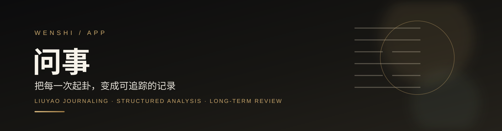
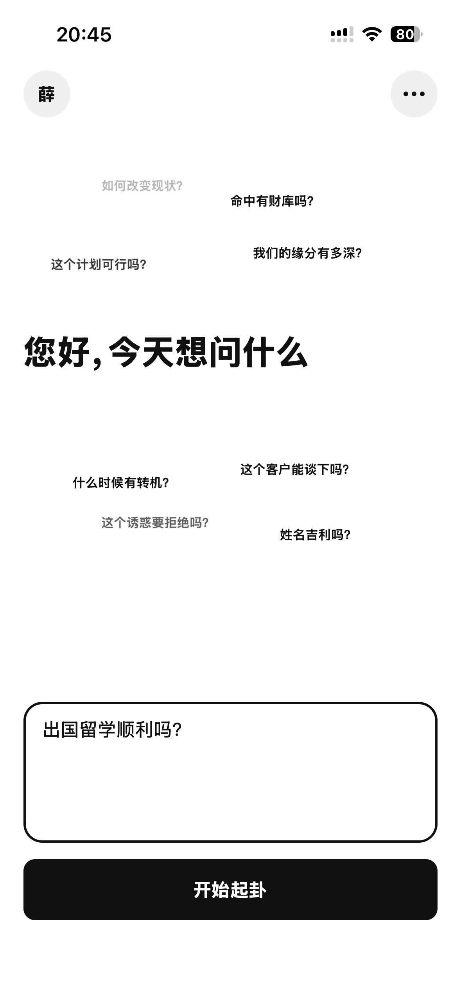
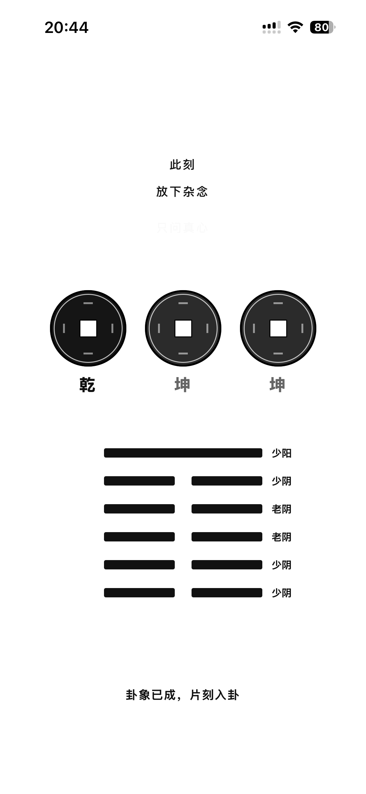
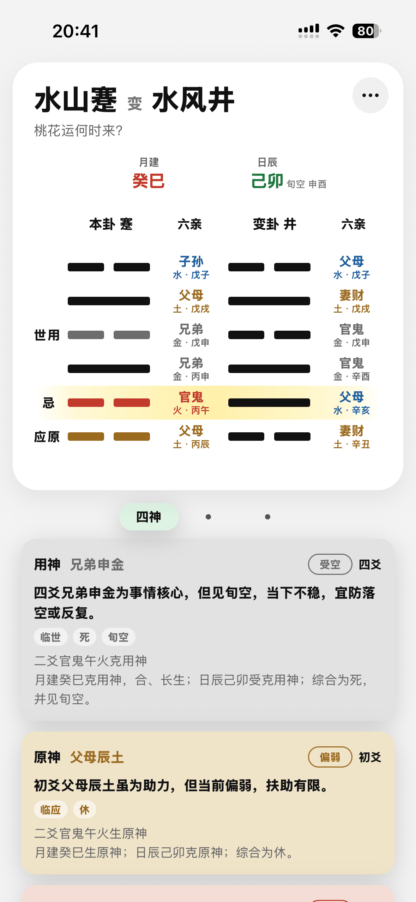
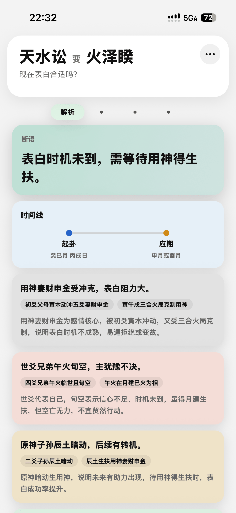
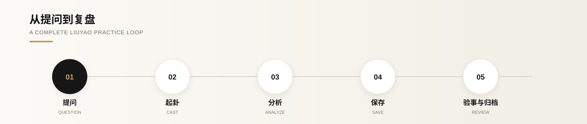
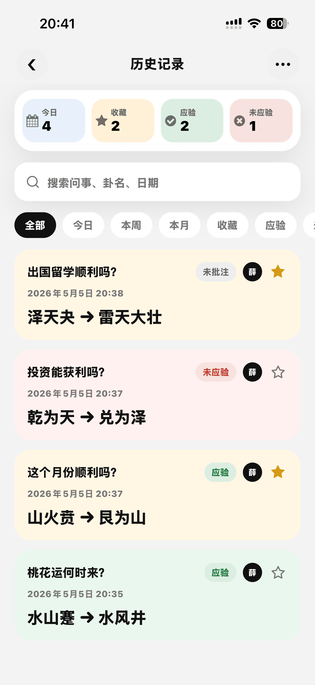
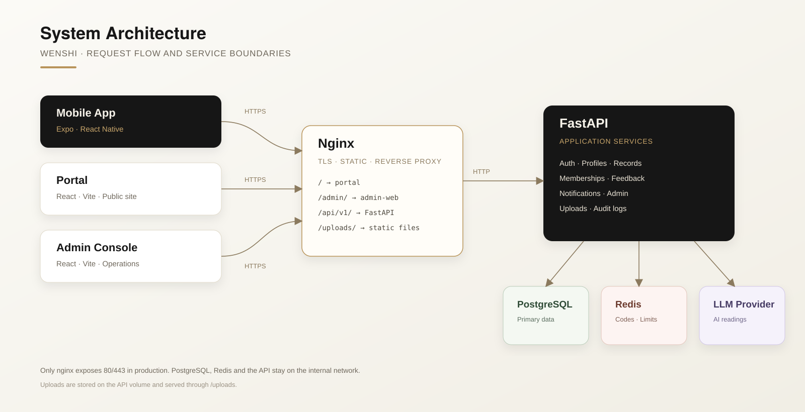

<p align="center">
  
</p>

# 问事 App

[](https://github.com/Xuezhihengg/wenshi_app/actions/workflows/ci.yml)
[](LICENSE)
[](https://expo.dev)
[](https://reactnative.dev)
[](https://www.typescriptlang.org)

问事是一款把传统六爻起卦、分析、记录与复盘流程数字化的移动应用。它不替你下结论，而是帮你把每一次判断留下来，日后回看。

> Wenshi is an Expo / React Native app for Liuyao (six-line divination) practice. Ask a question, cast a hexagram, read the structure, save the record, and review the outcome over time.

<p align="center">
  
  
  
  
</p>

## 功能

| 模块 | 能力 |
| --- | --- |
| 起卦 | 六爻起卦、动爻与变卦展示、月建日辰与旬空信息 |
| 分析 | 世应、用神、原神、忌神、合冲与旺衰等结构化解读 |
| 记录 | 本地 SQLite 缓存、登录后服务端同步、收藏与历史检索 |
| 复盘 | 验事状态、应期备注、按时间与标签回看 |
| 档案 | 本人、家人与合作方档案，支持不同咨询对象分别起卦 |
| 解读 | 服务端调用兼容 OpenAI 的模型，生成 AI 辅助解读 |
| 账号 | 手机号 / 邮箱验证码、Apple 登录、Google 登录 |
| 体验 | 中文 / 英文界面、深色模式、会员额度与反馈入口 |

## 使用流程

<p align="center">
  
</p>

## 记录与复盘

<p align="center">
  
</p>

每条记录会保留问题、时间、卦象、分析结果与验事状态。你可以按今日、本周、本月、收藏或应验状态筛选，在事件发生后补上批注，让一次起卦真正变成可回看的经验。

## 系统架构

<p align="center">
  
</p>

客户端负责起卦交互、结构化分析与本地缓存；登录后通过 [wenshi-server](https://github.com/Xuezhihengg/wenshi_server) 同步记录并请求 AI 解读。未登录或离线时，记录仍会保存在本机。

## 技术栈

| 层级 | 技术 |
| --- | --- |
| 运行时 | Expo SDK 54、React Native 0.81、React 19 |
| 语言 | TypeScript 5.9 |
| 导航 | React Navigation 7 |
| 存储 | Expo SQLite、AsyncStorage |
| 日历 | `lunar-typescript` |
| 登录 | 手机号 / 邮箱验证码、Apple Sign-In、Google Sign-In |
| 构建 | Expo CLI、Xcode、Android Gradle |

## 快速开始

### 环境要求

- Node.js 20.19+
- npm
- iOS：Xcode 与 CocoaPods
- Android：Android Studio 与 Android SDK

### 安装

```bash
git clone https://github.com/Xuezhihengg/wenshi_app.git
cd wenshi-app
cp .env.example .env
npm ci
```

### 启动

```bash
# 启动 Metro
npm run start

# 运行原生 App
npm run ios
npm run android
```

`npm run ios` 和 `npm run android` 需要本地原生开发环境。Google 登录包含原生模块，不能只在 Expo Go 中运行，需要重新构建原生工程。

## 连接后端

客户端需要 [wenshi-server](https://github.com/Xuezhihengg/wenshi_server)。在 `.env` 中配置 API 地址：

```env
EXPO_PUBLIC_API_BASE_URL=http://127.0.0.1:8000
```

| 运行环境 | 地址 |
| --- | --- |
| iOS 模拟器 / Web | `http://127.0.0.1:8000` |
| Android 模拟器 | `http://10.0.2.2:8000` |
| 真机 | `http://<电脑局域网 IP>:8000` |

生产构建必须设置 `EXPO_PUBLIC_API_BASE_URL`，否则应用会拒绝启动，避免误连开发地址。

开发环境默认允许使用 mock 验证码自动登录（固定验证码 `123456`）。如需关闭：

```env
EXPO_PUBLIC_ENABLE_DEV_LOGIN=0
```

该自动登录在正式构建中始终关闭。

## 环境变量

| 变量 | 必填 | 说明 |
| --- | --- | --- |
| `EXPO_PUBLIC_API_BASE_URL` | 生产必填 | 后端 API 地址 |
| `EXPO_PUBLIC_ENABLE_DEV_LOGIN` | 否 | 开发环境自动登录开关，默认开启 |
| `EXPO_PUBLIC_GOOGLE_WEB_CLIENT_ID` | 否 | Google Web OAuth client ID |
| `EXPO_PUBLIC_GOOGLE_IOS_CLIENT_ID` | 否 | Google iOS OAuth client ID |
| `GOOGLE_IOS_URL_SCHEME` | 否 | iOS URL scheme，格式为 `com.googleusercontent.apps.<client-id>` |
| `APP_BUNDLE_ID` | 否 | iOS Bundle ID 覆盖值，供 fork 使用 |
| `APP_PACKAGE` | 否 | Android package 覆盖值，供 fork 使用 |

`app.config.ts` 会读取 `APP_BUNDLE_ID` / `APP_PACKAGE` 覆盖 `app.json` 中的默认标识。发布 fork 前请改成自己的标识，并按 `.env.example` 配置自己的 Google OAuth client。未配置 Google client 时，登录页的 Google 按钮会提示暂不可用，其余登录方式不受影响。

## 常用命令

| 命令 | 说明 |
| --- | --- |
| `npm run start` | 启动 Metro |
| `npm run ios` | 构建并运行 iOS App |
| `npm run android` | 构建并运行 Android App |
| `npm run web` | 启动 Web 预览 |
| `npm run typecheck` | TypeScript 类型检查 |

## 目录结构

```text
App.tsx              应用入口
app.config.ts        Expo 动态配置
src/api/             API 客户端与认证
src/components/      通用组件
src/domain/          六爻领域模型与卦辞
src/i18n/            中英文文案
src/navigation/      页面导航
src/screens/         页面
src/services/        业务服务
src/storage/         本地数据库与设置
src/theme/           主题与配色
src/utils/           六爻计算与工具
```

## 检查

```bash
npm run typecheck
```

## 签名与发布

仓库不会包含 Android keystore、iOS 证书或 provisioning profile。请在本地或 CI 的密钥管理中保管，并通过 EAS / Xcode / Gradle 的本地配置注入。

发布前请确认：

- `APP_BUNDLE_ID` / `APP_PACKAGE` 与目标商店一致
- Apple / Google 登录的 Bundle ID、package、OAuth client 已更新
- `EXPO_PUBLIC_API_BASE_URL` 指向 HTTPS 生产地址
- 未提交 `.env`、keystore、证书或用户数据

## 关联仓库

- [wenshi-server](https://github.com/Xuezhihengg/wenshi_server)：FastAPI 后端、管理后台与部署编排
- [wenshi-portal](https://github.com/Xuezhihengg/wenshi_portal)：官网、隐私政策与反馈入口

## 安全

请勿在 Issue 中提交 Token、手机号、邮箱、截图中的个人信息或生产日志。漏洞报告方式见 [SECURITY.md](SECURITY.md)。

## 贡献

欢迎提交 Issue 与 Pull Request，开始前请阅读 [CONTRIBUTING.md](CONTRIBUTING.md) 和 [CODE_OF_CONDUCT.md](CODE_OF_CONDUCT.md)。

## License

[MIT](LICENSE)。项目名称、Logo 与截图不随代码许可授权，详见 [TRADEMARKS.md](TRADEMARKS.md)。
